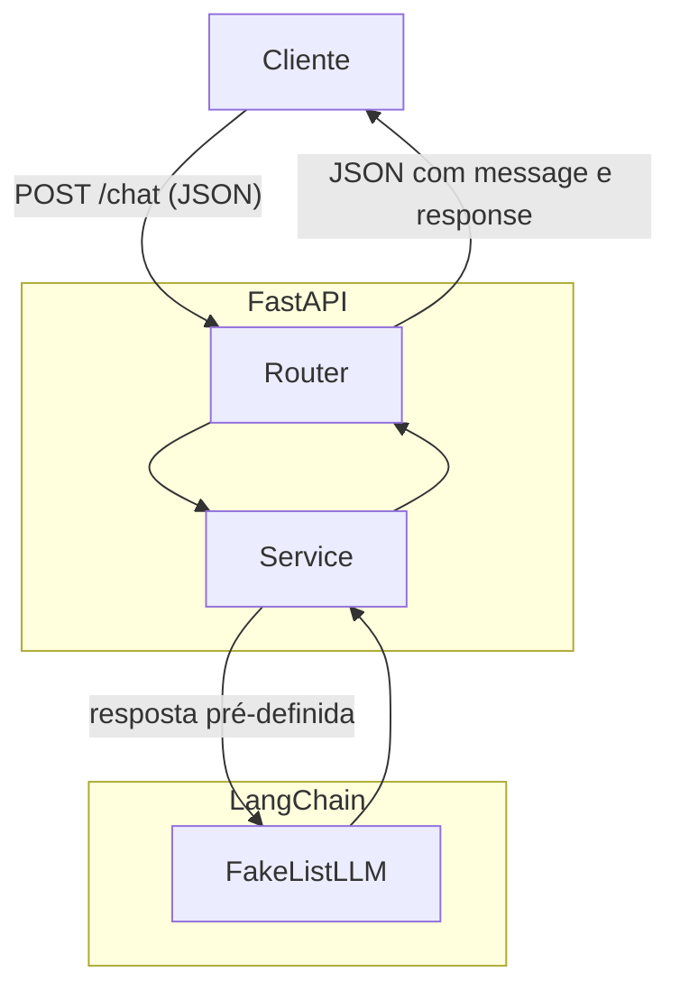

*README elaborado com ajuda da IA Grok 4.6 e revisado pelo autor do projeto.*

# Parte 2 — Questão 1: chatbot com Fake LLM

API FastAPI que simula um chatbot simples com LangChain. As respostas vêm de um 'FakeListLLM', sem chamar um modelo real.

## Como executar

Na pasta 'parte2_q1_chatbot_fake_llm', crie e ative um ambiente virtual, instale as dependências e inicie o servidor:

```
python -m venv .venv
.\.venv\Scripts\Activate.ps1
python -m pip install -r requirements.txt
python -m uvicorn main:app --reload
```

Com o servidor em execução, acesse:

- http://127.0.0.1:8000/docs — documentação interativa (Swagger UI)
- http://127.0.0.1:8000/redoc — documentação alternativa (ReDoc)

Em outro terminal, com o ambiente ativado:

```
python test.py
```

Perguntas pré-definidas: 'olá', 'qual é o seu nome?', 'em qual continente fica o brasil?' e 'como você funciona?'. Qualquer outra mensagem recebe a resposta padrão.

## Organização do projeto

- 'main.py': cria a instância FastAPI e registra as rotas.
- 'routers/chat_routers.py': define o endpoint POST '/chat'.
- 'services/chat_services.py': escolhe a resposta e envia para o 'FakeListLLM'.
- 'models/chat_models.py': modelos Pydantic de entrada e de resposta.
- 'test.py': exemplo de requisição HTTP com 'requests'.
- 'requirements.txt': bibliotecas necessárias.

## Por que usar Fake LLM

O Fake LLM serve para testar o fluxo da aplicação sem custo, sem chave de API e sem esperar um modelo baixar ou responder. A resposta é instantânea e previsível, o que facilita conferir rotas, validação JSON e a integração com o LangChain antes de ligar um LLM real.

## Arquitetura



1. O cliente envia uma mensagem em JSON.
2. O FastAPI valida o corpo da requisição.
3. O serviço escolhe uma resposta pré-definida.
4. O 'FakeListLLM' devolve essa resposta.
5. A API retorna a mensagem original e a resposta simulada.

## Rotas

- POST '/chat': recebe uma mensagem e retorna a resposta simulada.

Exemplo de corpo JSON:

```json
{
  "message": "Em qual continente fica o Brasil?"
}
```

Exemplo de resposta:

```json
{
  "message": "Em qual continente fica o Brasil?",
  "response": "América do Sul"
}
```
