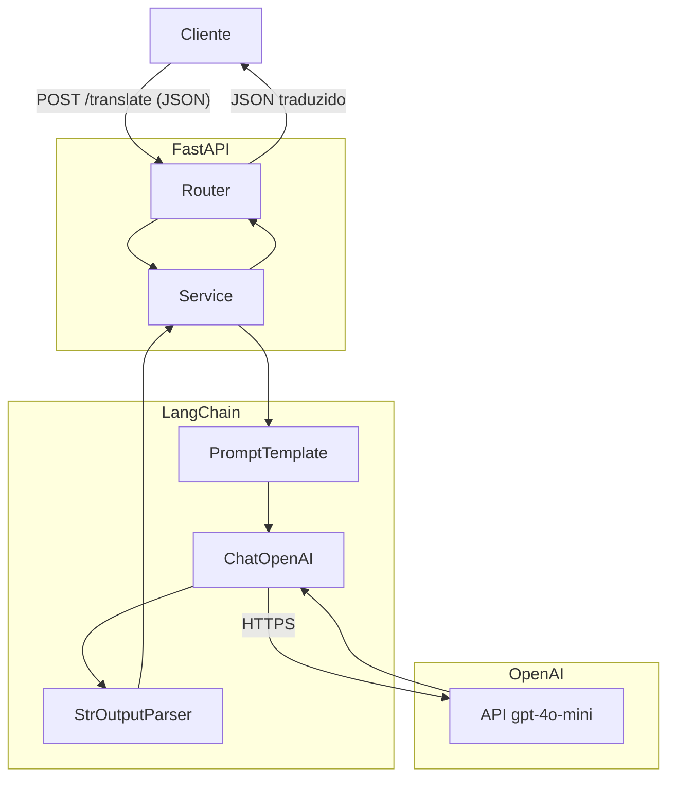

*README elaborado com ajuda da IA Grok 4.6 e revisado pelo autor do projeto.*

# Parte 2 — Questão 2: tradução inglês-francês com OpenAI

API FastAPI que traduz textos do inglês para o francês usando LangChain e a API da OpenAI. A chain é criada uma vez no serviço: 'PromptTemplate', 'ChatOpenAI' e 'StrOutputParser'.

## Como executar

Na pasta 'parte2_q2_traducao_openai', copie o arquivo de exemplo e coloque a chave da OpenAI:

```
copy .env.example .env
```

Edite o '.env' e preencha só esta linha:

```
OPENAI_API_KEY=sua-chave
```

Crie e ative um ambiente virtual, instale as dependências e inicie o servidor:

```
python -m venv .venv
.\.venv\Scripts\Activate.ps1
python -m pip install -r requirements.txt
python -m uvicorn main:app --reload
```

Com o servidor em execução, acesse:

- http://127.0.0.1:8000/docs — documentação interativa (Swagger UI)
- http://127.0.0.1:8000/redoc — documentação alternativa (ReDoc)

Em outro terminal, com o ambiente ativado:

```
python test.py
```

Se a chamada à OpenAI falhar, a API responde HTTP 502.

## Organização do projeto

- 'main.py': cria a instância FastAPI e registra as rotas.
- 'routers/translation_routers.py': define o endpoint POST '/translate' e trata erro da API externa.
- 'services/translation_services.py': monta a chain LangChain com OpenAI.
- 'models/translation_models.py': modelos Pydantic de entrada e de resposta.
- 'test.py': exemplo de requisição HTTP com 'requests'.
- 'requirements.txt': bibliotecas necessárias.
- '.env.example': modelo do arquivo '.env', sem a chave.

## Arquitetura



1. O cliente envia o texto em inglês.
2. O FastAPI valida o JSON.
3. O LangChain preenche o prompt de tradução.
4. O 'ChatOpenAI' envia a requisição para a API da OpenAI.
5. O parser devolve só o texto traduzido.
6. A API responde em JSON.

## Rotas

- POST '/translate': recebe um texto em inglês e retorna a tradução em francês.

Exemplo de corpo JSON:

```json
{
  "text": "Hello, how are you?"
}
```

Exemplo de resposta:

```json
{
  "original_text": "Hello, how are you?",
  "translated_text": "Bonjour, comment allez-vous ?"
}
```
