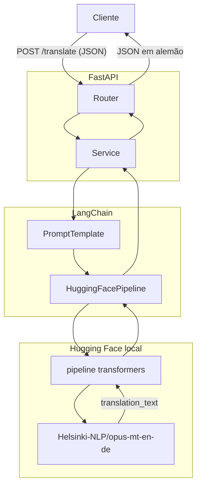

*README elaborado com ajuda da IA Grok 4.6 e revisado pelo autor do projeto.*

# Parte 2 — Questão 3: tradução inglês-alemão com LangChain e Hugging Face

API FastAPI que traduz textos do inglês para o alemão. O LangChain gerencia a chamada ao modelo 'Helsinki-NLP/opus-mt-en-de' por meio de um 'HuggingFacePipeline'.

## Como executar

Na pasta 'parte2_q3_traducao_hf_langchain', crie e ative um ambiente virtual, instale as dependências e inicie o servidor:

```
python -m venv .venv
.\.venv\Scripts\Activate.ps1
python -m pip install -r requirements.txt
python -m uvicorn main:app --reload
```

Na primeira execução, o modelo de tradução é baixado automaticamente. Com o servidor em execução, acesse:

- http://127.0.0.1:8000/docs — documentação interativa (Swagger UI)
- http://127.0.0.1:8000/redoc — documentação alternativa (ReDoc)

Em outro terminal, com o ambiente ativado:

```
python test.py
```

## Organização do projeto

- 'main.py': cria a instância FastAPI e registra as rotas.
- 'routers/translation_routers.py': define o endpoint POST '/translate'.
- 'services/translation_services.py': cria o pipeline da 'transformers', envolve em 'HuggingFacePipeline' e monta a chain.
- 'models/translation_models.py': modelos Pydantic de entrada e de resposta.
- 'test.py': exemplo de requisição HTTP com 'requests'.
- 'requirements.txt': bibliotecas necessárias.

## Arquitetura



1. O cliente envia o texto em inglês.
2. O FastAPI valida o JSON e chama o router.
3. O serviço preenche o 'PromptTemplate' com o texto.
4. O 'HuggingFacePipeline' encaminha o texto para o 'pipeline' da biblioteca 'transformers'.
5. O modelo 'opus-mt-en-de' gera a tradução em alemão.
6. O resultado volta pelo LangChain até a resposta JSON.

## Rotas

- POST '/translate': recebe um texto em inglês e retorna a tradução em alemão.

Exemplo de corpo JSON:

```json
{
  "text": "Hello, how are you?"
}
```

Exemplo de resposta:

```json
{
  "original_text": "Hello, how are you?",
  "translated_text": "Hallo, wie geht es dir?"
}
```
